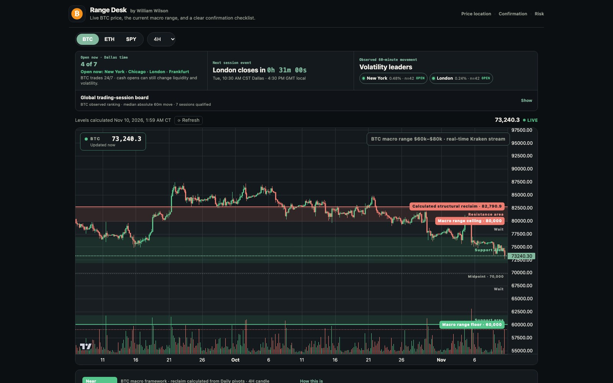
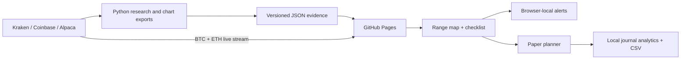

<p align="center">
  
</p>

<h1 align="center">Range Desk</h1>

<p align="center">
  <strong>Evidence-first market context for BTC, ETH, SPY, QQQ, NVDA, and XAU gold.</strong><br />
  Built by William Wilson to make price location, confirmation, and risk easier to assess without pretending uncertainty is a signal.
</p>

<p align="center">
  <a href="https://williamalexanderwilson.github.io/daily-levels/"></a>
  <a href="https://github.com/WilliamAlexanderWilson/daily-levels/actions/workflows/ci.yml"></a>
  <a href="https://github.com/WilliamAlexanderWilson/daily-levels/actions/workflows/deploy-pages.yml"></a>
</p>

<p align="center">
  <a href="https://williamalexanderwilson.github.io/daily-levels/">Live dashboard</a>
  &nbsp;·&nbsp;
  <a href="docs/RANGE-STRATEGY-RESEARCH.md">Range research</a>
  &nbsp;·&nbsp;
  <a href="docs/DECISION-LOCK.md">Decision rules</a>
  &nbsp;·&nbsp;
  <a href="docs/RANGE-OPEN-FORWARD-TRACKER.md">Forward evidence</a>
</p>

<p align="center">
  <a href="https://williamalexanderwilson.github.io/daily-levels/">
    
  </a>
</p>

---

Range Desk is my public market-research and decision-support workspace. It
turns named public data into transparent, testable context: live prices and
candles, calculated levels, global session timing, historical backtests,
prospective evidence gates, alerts, and browser-local paper planning.

## What makes it different

- **Live where the data is genuinely live.** BTC and ETH use Kraken's
  per-trade WebSocket stream; REST supplies history and reconnect fallback.
- **History loads without truncation.** Crypto intraday views page backward
  from Coinbase when the Kraken window ends; batch charts load immutable
  monthly archives as you scroll left instead of shipping a huge first page.
- **Fail-closed by design.** Missing evidence, stale marks, unverified market
  calendars, and failed holdout tests produce `WAIT`—not a manufactured call.
- **Research is separated from execution.** Historical observations,
  calculated context, and forward evidence are labeled independently.
- **Risk comes before leverage.** The paper planner requires stop/target
  geometry and caps account risk before calculating margin up to 100×.
- **Private by default.** Alerts and paper trades stay in the browser; no
  brokerage connection, account, or order-routing backend is involved.
- **Two honest candle views.** Regular candles show actual OHLC; optional
  Heikin Ashi candles smooth the same series for trend reading and are clearly
  treated as derived values rather than tradable prices.
- **SPY-only completed Heikin Ashi dojis.** SPY's loaded 15-minute-or-higher
  views mark completed derived candles whose body is no more than 10% of the
  full range. The forming candle is excluded, the markers are context—not
  entries—and BTC, ETH, QQQ, NVDA, and XAU do not display this study.

| Market | Data path | Current product boundary |
| --- | --- | --- |
| **BTC** | Kraken REST + per-trade WebSocket | Live chart, macro range, checklist, local alerts, paper planning |
| **ETH** | Kraken REST + per-trade WebSocket | Live chart, rolling levels, checklist, local alerts, paper planning |
| **SPY** | Alpaca IEX batch research | 20-session range context; failed strategy test remains fail-closed |
| **QQQ** | Alpaca IEX batch chart | 20-session range context; no live signal or paper P&L claim |
| **NVDA** | Alpaca IEX batch chart | 20-session range context; no live signal or paper P&L claim |
| **XAU** | Kraken PF_XAUTUSD spot-index archive | Delayed gold benchmark context; not an interbank execution quote or live signal |

> **A watch area is not an entry signal.** Three completed-candle price facts
> confirm behavior; the optional notification gate also requires measured
> session timing and minimum range reward-to-risk. Five checks produce a setup
> to assess, never an automatic order or promise of profit.

## System at a glance



The dashboard's calculations, tests, evidence rules, interface, and ongoing
validation all live in this repository. Outside commentary may explain why a
question was investigated, but it is never treated as market data, a copied
signal, or proof of an edge.

## Data and methodology boundary

The project separates four kinds of information instead of blending them
together:

1. **Market data** from identified providers such as Kraken, Coinbase Exchange,
   and Alpaca IEX.
2. **Calculated context** produced by this repository, including pivots, volume
   profiles, confluence zones, session measurements, and structural levels.
3. **Historical tests** that preserve sample sizes, assumptions, negative
   results, and known modeling limitations.
4. **Dated discretionary context** that may explain why a watch area was first
   investigated but is never presented as measured evidence or a trading
   signal.

For example, the structural reclaim is independently reconstructed once a day
from completed Kraken Daily candles: repeated pivot highs within 2% form a
candidate cluster, and the strongest durable cluster's exact high becomes the
boundary. The current result traces `$82,790.90` to May 6, 2026, with later
tests retained as evidence. Its frozen method and limitations are documented
in [`docs/STRUCTURAL-RECLAIM.md`](docs/STRUCTURAL-RECLAIM.md).

<details>
<summary>Historical reference behind one original BTC watch area</summary>

An early version of the BTC screen investigated a discretionary range discussed
in public market commentary. Those videos are retained only to explain why that
dated area was examined; they do not control the calculated levels, backtests,
prospective observations, or conclusions produced by this project.

- https://youtu.be/cOxjsDvGRTA
- https://youtu.be/HBKEvXjDbS0
- https://youtu.be/v3fXVye-TVg?t=64

</details>

The **Patience gate** then requires three visible facts before calling the
chart a setup worth reviewing:

1. Price is in a sourced watch area, not merely near an arbitrary level.
2. A completed candle actually traded through the selected support or
   resistance boundary.
3. That completed candle closed back inside the selected zone (above support
   for a long watch, below resistance for a short watch).

The still-forming candle is always excluded. All three conditions produce
“setup to assess,” never an automatic order; stop placement, size, and the
trader's own confirmation remain separate decisions.

### SPY, QQQ, and NVDA completed-session ranges

Each U.S. equity chart maps one fixed, reproducible channel from the prior 20
completed regular sessions (9:30 AM–4:00 PM New York time): the highest high,
lowest low, midpoint, and the outer 15% watch zone at each edge. The current
session is excluded until it closes, and extended-hours prints never set a
boundary. Price inside a watch zone means “wait for completed-candle behavior”;
price in the middle means `WAIT`; price outside the channel is never treated as
an automatic fade.

These levels describe location, not a demonstrated trading edge. The exports
use Alpaca's free IEX feed, which represents one exchange rather than the
consolidated SIP market, and refresh in scheduled batches. SPY's separate
preregistered strategy test remains negative and fail-closed even though its
chart now shows the same descriptive range geometry.

### XAU gold benchmark

The XAU tab uses Kraken's public `PF_XAUTUSD` spot-index chart as delayed gold
benchmark context. The scheduled exporter pages the source into monthly
archives and the browser loads older months only when requested. The UI does
not call this an executable interbank XAU/USD quote, does not attach a live
paper P&L stream, and does not turn the 20-day location range into a signal.

When that latest completed candle passes the gate, the chart adds a
**LIVE LONG SETUP ✓** or **LIVE SHORT SETUP ✓** marker. An older reclaim can
remain useful history, but it cannot masquerade as a current live setup.

SPY, QQQ, NVDA, and XAU each show their own batch publication time in Dallas
time. A batch older than 18 hours gets an asset-specific stale warning. If one
of these exports fails, the scheduled workflow retains its prior files, lets
unaffected changes deploy, then fails with a summary naming the affected asset.

The optional **setup alert** starts with those same three price facts, then
also requires (4) one of the asset's two measured volatility-leading sessions
to be open or within 30 minutes and (5) the selected minimum range
reward-to-risk to be available. It emits one in-page alert per unique completed
candle only at 5/5. **Send test** verifies delivery; **Plan paper trade** opens
the existing paper planner with the direction and minimum R:R carried over.
If browser notifications are allowed, the same one-time alert can appear while
the tab is hidden. Range Desk must remain open; closing the site stops alerts.
The opt-in setting and short deduplication history are stored only in that
browser's localStorage; no account, server, Telegram bot, or trading connection
is involved. SPY stays fail-closed because its preregistered live rule did not
pass validation.

## Global market-open clock

All six market views share one compact global-session clock. It keeps
the chronologically next major market open visible with a one-second countdown
in William's Dallas/Central time, while a collapsed list shows seven regular
sessions ranked from observed median 60-minute movement when at least 20
complete samples exist: New York cash, Chicago CME U.S. index
futures, London, Tokyo, Hong Kong, Frankfurt/Xetra, and Sydney. BTC and ETH are
correctly labeled 24/7; these opens are liquidity/volatility context, not
periods when crypto itself opens.

Session calculations use each exchange's IANA timezone, so daylight-saving
changes are automatic. Cash clocks model regular Monday-Friday hours; CME
also models its Sunday-Friday session and daily 4:00-5:00 PM Central halt.
Alert eligibility uses verified 2026-2027 holiday and half-day calendars for
the currently measured New York, London, and Hong Kong leaders and fails closed
outside verified calendar coverage. Severe-weather changes and emergency
closures can still override scheduled calendars, so every row links to the
exchange's official hours/calendar.
BTC/ETH use a visible 60-day Coinbase Exchange sample; SPY uses the existing
Alpaca IEX history and leaves opens without exact SPY candles unranked. These
are source-specific historical measurements, not a claim that one exchange is
universally more important or predictive in every market regime.

## Paper journal review

The browser-local journal separates open positions from completed paper
trades, then reports wins, losses, win rate, average planned R, average
realized R, results by market, and results by the recorded range location.
It can export the complete local record as CSV. The summary describes the
user's paper history only; it is not presented as a validated strategy edge.

### Range × open forward test

The compact forward panel begins at the frozen `2026-11-08T00:00:00Z` cutoff.
For every eligible session open it computes a 60-calendar-day range from
strictly earlier candles, labels the opening location `LOWER EDGE`, `UPPER
EDGE`, or `WAIT`, and records raw 15/30/60/120-minute movement. Existing event
ranges and opening prices never change; missing outcome candles leave an event
pending rather than manufacturing a flat result.

The panel cannot headline a reaction rate until it has 50 resolved edge opens,
including at least 20 lower-edge and 20 upper-edge observations. Even after
that gate it remains descriptive underlying-price evidence—not a signal,
options result, leverage result, or profitability claim. The immutable rules
are in [`docs/RANGE-OPEN-FORWARD-TRACKER.md`](docs/RANGE-OPEN-FORWARD-TRACKER.md).
Coincident sessions such as London and Frankfurt remain visible as separate
rows but count as one opening cohort toward the evidence gate.

The BTC chart marks the complete macro range behind the candles, including
the $70k midpoint, $72k-$77k support zone, $80k ceiling, and calculated
structural reclaim (currently `$82,790.90`, displayed near `$82.8k`).
Nearby rolling levels sit in the closed **Research & details** panel. Opening it
restores the broader level radar, order-book walls, and evidence-labeled
liquidation model. A persistent ticker shows the latest Kraken price and the
age of the last successful update.

## How it works

1. A GitHub Action checks every three hours because scheduled runs can be
   delayed. `src/run.py` performs at most one daily level refresh per asset,
   based on whether today's snapshot already exists rather than requiring one
   exact wall-clock hour.
2. The engine (`src/levels/engine.py`) fetches 4h and daily OHLC candles
   from Kraken's public API for `BTC/USD` and `ETH/USD`, runs the volume
   profile / pivot / golden pocket / reference-level / flip-level
   calculations, merges nearby levels into confluence zones, reconstructs the
   BTC structural reclaim from repeat-tested Daily pivot highs, and writes the
   result with its provenance as JSON into `site/data/`.
3. The same Action run also replays history day by day (`src/backtest/`)
   to build a hold-rate scorecard — how often each level type has
   historically held vs. broken when touched — and writes that alongside.
   It also refreshes market-open reaction research roughly once per day and
   advances the preregistered range-open forward record.
4. The Action commits those JSON files to the repo, then deploys the site
   to GitHub Pages itself (see "Why Pages deploys from the workflow"
   below).
5. The static site in `site/` reads the levels/scorecard JSON for its
   lines, labels, and table — that part only updates once a day. The
   **forming candle and visible price stream directly from Kraken's public
   WebSocket on every trade** — there is no server, API key, or database.

## Local setup

```bash
python3 -m venv .venv
source .venv/bin/activate
pip install -r requirements.txt
npm ci
npx playwright install chromium

# run the level engine for real (writes into site/data/)
python -m src.run --force

# run the backtest scorecard for real (writes into site/data/)
python -m src.backtest.cli

# refresh BTC/ETH session reaction and range-open research
python -m src.session_reactions.cli --force

# run the tests
python -m pytest
npm run check:js
npm test
npm run test:browser

# view the site locally
cd site && python3 -m http.server 8000
# open http://localhost:8000
```

The `Quality` GitHub Actions workflow runs the same regression suite on every
pull request and push to `main`. Its browser job exercises the dashboard in
desktop Chromium and a mobile viewport, including asset switching, responsive
layout, market-specific branding, URL state, page title, and favicon behavior.

`--force` bypasses `src.run`'s once-per-day snapshot check, which is what you
want for a deliberate manual refresh. `src.backtest.cli` isn't time-gated; it
replays history rather than "now."

## Why Pages deploys from the workflow, not "deploy from a branch"

GitHub Pages' classic "deploy from a branch" source only serves `/` or
`/docs`, not `/site`. Pages is instead configured with `build_type:
workflow`, and `update-levels.yml` deploys it directly after committing
new data (`actions/upload-pages-artifact` + `actions/deploy-pages`). That
also sidesteps a real gotcha: a push made with the default `GITHUB_TOKEN`
(the Action's own commit) does **not** trigger another workflow's `on:
push` — GitHub suppresses that to prevent recursive runs — so a separate
"deploy on push" workflow would never actually fire after the daily data
update. `deploy-pages.yml` still exists for the case of editing `site/`
directly and pushing it yourself with your own credentials, which does
trigger normally.

Both deployment paths wait for the uploaded Pages artifact to appear in the
Actions API before calling `deploy-pages`. This avoids an observed artifact
indexing race; rerunning a failed deployment job can instead create two
same-named artifacts, so start a fresh workflow run if a deployment retry is
needed.

To (re)enable Pages on a fork or a new repo:

```bash
gh api -X POST repos/<owner>/<repo>/pages -f "build_type=workflow"
```

## Triggering a manual run

GitHub → Actions → "Update levels" → **Run workflow**. This calls
`python -m src.run --force`, bypassing the 5 AM Central gate, so it always
does a real fetch-and-recalculate regardless of when you click it, then
runs the backtest and deploys.

You can also trigger it from the CLI:

```bash
gh workflow run update-levels.yml
```

## The live chart vs. the daily levels

These are two independent systems that happen to share one page:

- **Levels** (the lines, zones, and tables) come from the once-a-day
  snapshot in `site/data/{asset}_levels.json` and `_scorecard.json`. Fixed
  until the next 5 AM run — that's deliberate, it's what makes them a
  stable reference instead of a moving target.
- **The chart** loads its history through Kraken REST, then subscribes to
  Kraken's public WebSocket v2 OHLC channel for the selected market and
  timeframe (1m/5m/15m/30m/1h/4h/Daily). Kraken publishes an updated
  forming candle on every trade, so both the ticker and candle move without
  waiting for a timer. The REST fetch remains a 10-second reconnect fallback
  only, with retry/backoff for Kraken's occasional missing CORS response.
- Every timeframe opens fitted to all history loaded for that view. Mouse,
  trackpad, and touch navigation can then pan or zoom both axes, while the
  **Fit all** control restores the complete-history frame and automatic price
  scale.
- The **Regular / Heikin Ashi** control changes candle presentation only.
  BTC/ETH Heikin Ashi bars are derived in the browser from the real Kraken
  series, and equity Heikin Ashi bars are derived from each exported real-OHLC
  timeframe. Range calculations, evidence gates, and paper marks continue to
  use real prices.
- **Daily shows real history back to 2015/2016, not just ~2 years.**
  Kraken's public OHLC endpoint always returns just its most recent ~720
  candles no matter what date you ask for (confirmed directly - there's no
  way to page further back on it, from the browser or a server), so Daily
  pulls everything older than that from Coinbase's public candles endpoint
  instead (also CORS-friendly, no key, real daily data since BTC-USD's
  2015 and ETH-USD's 2016 listing there), paginated and merged with
  Kraken's own fetch, which still owns the live/most-recent end exactly as
  before. Loads progressively - Kraken's fast ~2-year window renders
  first, the deeper history pops in a few seconds later once Coinbase's
  dozen or so paginated requests finish, so Daily is never blank waiting
  on it, and if Coinbase is ever unreachable it just quietly stays at the
  ~2-year view instead of breaking. Daily also switches the price scale to
  logarithmic for this reason - BTC/ETH have moved through multiple orders
  of magnitude over that stretch, and a linear scale would squash anything
  before ~2020 into a flat line at the bottom.
- **Order book liquidity walls** are also live-only: `fetchOrderBookWalls`
  polls Kraken's public spot order book (`/0/public/Depth`) every 10 seconds,
  independently of the per-trade price stream, and shows the top 3 bid/ask price levels per side that are
  at least 2x the book's median resting size — real orders sitting on the
  book right now, not a modeled estimate. (A true liquidation heatmap
  would need every trader's entry price and leverage across every
  exchange, which no exchange publishes — that's what tools like
  Coinglass are actually estimating, not displaying as fact. Kraken
  Futures' open-interest/funding endpoint has no CORS header at all, so
  it isn't fetchable from the browser at all; it would need to go through
  the daily Python engine instead, same as everything else that isn't
  live.)
- **Click any row in the Level table to snap the chart to it** — zooms the
  price axis to frame that level tightly. Click the same row again (or
  select a different one) to go back to the default view.

## The hold-rate scorecard

`src/backtest/` replays the level engine day by day over the full ~2 years
of daily history Kraken's API allows, using **only** data that would have
existed as of each replayed day (`src/backtest/replay.py` — no lookahead,
proven by `tests/test_backtest_replay.py`). For every level touched, it
classifies the outcome over the following 10 days as a **hold** (price
moved `BACKTEST_HOLD_MOVE_PCT` away from the level before any close landed
`BACKTEST_BREAK_CLOSE_PCT` beyond it) or a **break** (the reverse
happened first); if neither resolves within the window, it's
"inconclusive" and excluded from the hold rate rather than forced into
either bucket.

One real constraint: Kraken caps history at 720 candles regardless of
interval, so 4h candles only reach back ~120 days — too thin to backtest
the volume-profile levels (POC/VAH/VAL/Range) on their native timeframe
with a usable sample size. `src/backtest/engine.py` computes those specific
levels from **daily** candles instead, same methodology, coarser bins, far
deeper replay history (~720 days vs. ~60). The live engine is untouched —
this is a backtest-only approximation, and the scorecard flags anything
under `BACKTEST_MIN_TOUCHES_CONFIDENT` (30) resolved touches as
low-confidence.

This is historical frequency, not a prediction — the site says so right
next to the table.

**Round numbers** ("Round number" in the scorecard) are included as a
level type too — psychological whole-number levels ($85,000 for BTC,
$2,700 for ETH), scaled to price magnitude (`src/levels/round_numbers.py`:
step = `10**(digits-2)`, so $1,000 steps for a five-figure BTC price,
$100 for four-figure ETH). Unlike every other level, these are purely
arithmetic, not derived from trade data, so they're **not** part of the
once-a-day snapshot — the live site recomputes the nearest one
continuously from the live price (reimplemented in `site/app.js`; keep
both in sync if the formula changes), while the backtest tests them the
same way as everything else: not "did price print the exact dollar
amount," but "did it come within `ROUND_NUMBER_TOLERANCE_FRACTION` of a
step (a quarter-step — $250 for BTC) and then hold or break." Tested
across every round number the price actually traded near over the full
replay — dozens of distinct values per asset, not just whatever's current
today.

## BTC Range Lab

`python -m src.range_lab.cli` runs a separate, no-lookahead range-rejection
experiment over public Kraken `PF_XBTUSD` 4-hour candles. It compares fixed
dollar, percentage, ATR-normalized, and structure-based ranges. Every setup
uses only preceding candles to define its range, waits for a completed
edge-rejection candle, and enters at the next candle's open.

The report includes modeled fees and slippage, pessimistically treats a
same-candle stop/target collision as a stop, selects a candidate using only
the fixed validation period, and then reports a locked historical holdout with
permanent calendar boundaries. The generated `site/data/btc_range_lab.json` is research
evidence, not a profitability promise or an instruction to trade.

The same artifact also contains a **prospective paper record** beginning at
the permanently frozen `2026-11-06 04:00 UTC` boundary. All six definitions
are observed separately because none currently qualifies as validated; their
returns are never combined into a portfolio. A paper position remains open
until its target, stop, or full maximum holding window is actually observed —
the refresh job never invents an early time exit merely because the newest
candle is the end of today's data. This record places no orders.

The preregistered `range-forward-gate-v1` patience screen evaluates each
candidate independently and can only label it a **forward-qualified research
candidate** after 50 closed observations, positive base and stressed edge with
profit factor at least 1.20, maximum drawdown no greater than 20%, positive
chronological halves, and positive long and short subgroups. The full record is
rechecked on every refresh, so qualification can be revoked. At the first
post-implementation refresh, every candidate was still at 0/50 closed; three
had open paper observations and none qualified. The dashboard shows this gate
prominently ahead of the collapsed historical diagnostics.

When the existing alert preference is enabled, the open tab checks the Range
Lab artifact every five minutes and can show one deduplicated local notice when
a paper observation opens or closes. The first snapshot is silent, disabled
alerts create no backlog, and the browser must remain open; this is not a
background monitoring service or an order system.

It also reconciles the futures research feed against the completed Kraken
BTC/USD spot 4-hour candles available from the bounded spot endpoint. The
2026-11-06 comparison found 720 aligned timestamps with no gaps, +0.0072%
mean futures close basis, 0.0340% p95 absolute close difference, and 98.33%
candle-direction agreement. That supports using the spot chart as nearby
visual context over the measured window; it does **not** make spot and futures
identical execution markets or validate the strategy.

Range Lab also includes the preregistered `range-exit-runner-v1` sensitivity
test: the baseline closes 100% at midpoint; the comparison closes 50% there
and leaves 50% for the opposite boundary without moving the original stop.
Every runner definition was still negative in validation, even though the
10%–20% version looked positive on the already-viewed historical holdout. Both
exits use the exact same entry cohort, with overlapping runner observations
allowed so holding time cannot change which signals are compared. The UI
therefore shows the comparison inside a collapsed detail instead of promoting
it as an entry or exit instruction.

The preregistered `range-walk-forward-v1` diagnostic then runs each unchanged
baseline definition continuously across seven completed six-month windows
from 2023 H1 through 2026 H1. Trades are bucketed by entry time without
resetting or truncating positions at window boundaries. A window needs at
least 10 trades to count; the frozen stability screen requires at least four
eligible windows, 75% positive eligible windows, positive aggregate
expectancy, and aggregate profit factor above 1. No definition passed.
Structure had the most coverage (6 eligible windows, 2 positive) but remained
negative overall (-0.4814% expectancy, 0.742 PF, 46.83% max drawdown). The UI
keeps the seven-window detail collapsed and marks small samples rather than
turning isolated historical wins into a signal.

The frozen `range-robustness-v1` screen uses that exact walk-forward cohort to
show long versus short results, paired base/stressed/severe execution costs,
and the longest compounded-equity drawdown duration. It requires 60 total
trades, 30 per direction, positive expectancy and PF above 1 for both
directions and every cost scenario, plus an already-passed walk-forward
screen. No definition passed. Structure was the only definition with adequate
overall and per-direction samples, but long expectancy was -0.0832%, short
expectancy -1.0226%, and severe-cost expectancy -1.0830%; its longest
unrecovered spell lasted 75 trades / 1,011.67 days. The UI keeps this detail
collapsed and displays explicit low-sample warnings.

## Futures context (funding rate, open interest)

`src/context/futures.py` fetches Kraken Futures' aggregate perpetual data
server-side, once a day, and bakes it into `{asset}_levels.json` as
`futures_context` — read directly off the already-loaded levels JSON on
the site, no extra client-side fetch. It's server-side because the
endpoint (`futures.kraken.com/derivatives/api/v3/tickers`) sends **no
CORS header at all** (checked directly), unlike every other Kraken
endpoint this project uses.

Two things worth knowing if you touch this: the ticker's `fundingRate`
field is **not a percentage** — it's an absolute rate (BTC per $1 contract
per hour); `relativeFundingRate` is the field exchanges actually display
as "the funding rate" (confirmed against Kraken's docs and a live
response — using the wrong field would show a nonsensical ~60% instead of
the real ~0.0008%). And Kraken Futures pays funding **hourly**, not every
8 hours like most exchanges — the site labels it "/hr" explicitly so it
isn't misread against an 8h mental model.

## Exhaustion pattern (Daily timeframe)

Detects the same kind of candle pattern SPY's backtest is built around (a
run of same-direction Heikin-Ashi candles followed by a doji whose
rejection-side wick exceeds every preceding trend candle's range), applied
to BTC/ETH's own daily candles. **This reports a pattern, not a call** — if
one just formed, a banner above the chart says so and shows how often this
exact shape has reversed historically (with sample size, and a
low-confidence flag below 30 resolved occurrences) — never "buy" or "sell."

Computed once a day in the same engine run as every other level on this
site (`src/levels/exhaustion_pattern.py`), not streamed live — same cadence
as POC/VAH/VAL/golden pocket, not the real-time price path.
Most days nothing is detected at all; this is a specific, fairly rare
candle shape, not a "there's always something nearby" kind of level.

The historical reversal rate (`src/backtest/exhaustion_pattern.py`) is a
row in the hold-rate scorecard table below ("Exhaustion pattern"), tested
the same touch/hold/break way as every other row: did price move back in
the called direction before closing further the other way, within the next
10 days.

## Liquidation estimate (the green/red background heatmap)

**This is a model, not real position data** — no exchange, Kraken
included, publishes actual entry prices or leverage, so nothing can show
*verified* liquidation levels. What's shown instead: the real volume
profile (actual traded volume at each price over the lookback window —
the same data POC/VAH/VAL are built from) projected through a handful of
standard perp leverage tiers (10x/25x/50x/100x):

```
long liquidation price  = entry * (1 - 1/leverage)   # below entry
short liquidation price = entry * (1 + 1/leverage)   # above entry
```

Each volume bin's volume is split evenly across every leverage tier and
evenly between long and short, because there's no real signal to weight
either split any other way — Kraken's open-interest number is a single
aggregate, it doesn't say how it splits by side or leverage. An even
split is the most honest default available, not a claim that longs and
shorts were actually equal there.

The result (`src/levels/liquidation_estimate.py`, baked into
`{asset}_levels.json` as `liquidation_estimate`) is a **relative**
density, not an absolute size — a bin twice as "hot" as another means
twice as much real volume projects a liquidation there, not "twice as
many dollars" or "this will definitely happen." Rendered as a soft,
blurred wash across the full width of the chart, sitting behind the
candles the same way a Coinglass-style heatmap does — not a sidebar or
a strip off to the edge. Green rows mean estimated long liquidations
dominate at that price, red means short; brightness carries the
modeled intensity. The browser preserves the model's global ranking and
hides bins below 80% of its peak, so a weak area cannot be promoted into
a fake hotspot merely because the strongest cluster is off-screen.
Capped to within 25% of the current price so it doesn't extrapolate off
into irrelevant territory. Treat it the way you'd treat any third-party
liquidation heatmap: a plausible read on where crowded leverage might
sit, built transparently from real data plus one stated, simple
assumption — not a fact.

## Paper position tracker

The chart is now the first major dashboard surface. Directly beneath it,
the paper tracker can use the current streamed mark, a tapped chart price,
or a manually typed fill. The risk-first ticket requires long/short, account
balance, risk percentage (capped at 2%), stop, target, and 1–100x leverage.
It calculates position notional and required margin from the stop distance;
leverage changes margin, not the dollars selected for risk. `site/app.js` saves the position to
**this browser's localStorage**, keyed per
asset. There's no server or account involved, so it won't follow you to a
different browser or device, and clearing site data wipes it (a
deliberate tradeoff — the alternative was a real backend). Markers render
on the chart via lightweight-charts' `createSeriesMarkers` plugin API
(v5's replacement for v4's `series.setMarkers`), and a trade is stored by
a canonical unix timestamp rather than whatever display format the active
timeframe happened to use at click time, so it renders correctly on any
timeframe later, as long as that timeframe's currently-loaded candles
actually cover it.

The open-position card shows entry, current mark, stop, target, current R,
planned R, dollars at risk, notional, running P&L, and a deliberately rough
liquidation estimate. The active position also adds entry, stop, target, and
estimated-liquidation lines to the chart. The 100x ceiling is
enforced in both the UI and the calculation module. The estimate excludes
maintenance margin, fees, funding, and exchange-specific liquidation
rules, so it is a risk warning rather than a quote. If the live stream
crosses that estimate, the local paper position closes there at -100% of
margin and cannot later appear to recover after it should have liquidated.
While Kraken is reconnecting, new live-mark entries are disabled and open
P&L is labeled `last mark`, not `live`.

The ticket sizes notional as `risk dollars / stop distance %`, then calculates
required margin as `notional / leverage`. It refuses invalid stop/target
geometry, risk above 2%, a stop beyond the rough liquidation estimate, or a
position whose calculated margin exceeds the entered account balance. The
trades table updates live P&L and R, then freezes the exact result and labels
the reason when stop, target, estimated liquidation, or a manual close ends the
paper trade. Legacy local trades remain readable even when they lack the new
risk fields.

The paper ticket also contains a tested **Decision Lock**. It stays locked
unless the current three-part market checklist is ready, direction matches the
confirmed edge, the stop is beyond invalidation, the first target stays inside
the opposite range boundary, and the plan meets the user's stated minimum-R
rule. Passing means only `paper-eligible`; it is not a signal or a claim that
the trade will win. See `docs/DECISION-LOCK.md` for the frozen rules and risk
sources.

**Close a trade with "Close at mark"** in its row — the current streamed
price is prefilled but can be replaced with the actual exit. Confirming
freezes the P&L at that exit price for good (it stops
following the live price) and adds a second marker on the chart at the
exit point, colored by whether it was a win or a loss.

BTC and ETH use Kraken's real-time stream. SPY remains visibly disabled in
the paper tracker because its chart is batch-generated; the site does not
present a stale SPY mark as live P&L. On narrow screens the chart stays
near the top, controls become full-width touch targets, and the history
table scrolls within its panel.

## Jump to a level

The "Jump to level" dropdown above the chart lists every level from the
Level table, closest to the live price first, and snaps the chart to
whichever one you pick — same as clicking its row in the table below
(they stay in sync with each other either way). Each entry also shows a
live percentage: 0% means price is sitting at the nearest level on the
*other* side, 100% means price has arrived at this one — so as price
moves toward a level, its number climbs. It's anchored on the two real
levels price is actually between, not an arbitrary cutoff, so a level
further away naturally shows a lower percentage than one price is about
to touch.

**Every colored tag on the chart itself is also clickable** — not just
table rows and the dropdown. Click an order book wall or a round-number
proximity band directly and the chart snaps to it, on whichever timeframe
you're on. When a lot of lines are bunched together (a sharp move tends
to stack order book walls right on top of each other), clicking one also
**isolates** it — every other line and label hides so you can see exactly
which one you picked and what it is. Click it again (from the chart, the
table, or the dropdown — all three stay in sync) to bring everything back.

**You can click the line itself, not just its tag** — decluttering can
push a tag's label well away from its actual line when things are
crowded, so clicking anywhere along the real line (the cursor turns into
a pointer when you're close enough) isolates it exactly the same way.
A tag also only ever shows when its line is actually somewhere on screen
— nothing is pinned to the edge with an arrow pointing off into the
distance.

**Proximity curve** (`src/backtest/round_proximity.py`,
`{asset}_round_proximity.json`): re-runs the round-number touch/hold/break
classification at 6 tolerance widths instead of 1 (100%/50%/25%/10%/5%/2%
of a step), to test whether the odds actually change depending on how
close price gets before reacting, rather than assuming one number covers
it. They do, substantially — hold rate drops the closer price gets to the
exact number (BTC: 55%→42% from a full step away down to 2%; ETH:
69%→40%), for both assets, with 600+ resolved touches even at the
tightest tier. The site shows this as 3 of the 6 tiers rendered as nested
bands around the live nearest round number, each labeled with its own
hold rate.

## Config (`config.py`)

Every tunable number lives in `config.py`, each with a comment explaining
it. The ones worth knowing about up front:

| Setting | What it controls |
|---|---|
| `RANGE_DAYS` | Lookback window (in days of 4h candles) for the volume profile and range high/low. |
| `VOLUME_BIN_PCT` | Width of each volume-profile bin, as a fraction of current price. |
| `VALUE_AREA_PCT` | Fraction of volume the value area (VAH/VAL) must cover, expanding out from the POC. |
| `PIVOT_N` | How many candles on each side must be lower/higher for a candle to count as a swing pivot. |
| `MIN_SWING_PCT` | Minimum % move for a leg between two pivots to qualify for the golden pocket calculation. |
| `GOLDEN_POCKET_LOW` / `GOLDEN_POCKET_HIGH` | The Fibonacci retracement band (0.618–0.65) applied to the most recent qualifying swing leg. |
| `PIVOT_LOOKBACK_DAYS` | How far back into daily candles to search for pivots and swing legs. |
| `CONFLUENCE_MERGE_PCT` | Levels within this % of each other are merged into one zone. |
| `STALE_AFTER_HOURS` | How old `generated_at` can get before the site shows a stale-data warning. |
| `RUN_HOUR_LOCAL` | The Central-time hour `src/run.py` treats as "the daily run" (5 AM). |
| `BACKTEST_FORWARD_DAYS` | How many days forward the scorecard watches for a touch to resolve as hold/break. |
| `BACKTEST_HOLD_MOVE_PCT` / `BACKTEST_BREAK_CLOSE_PCT` | The hold vs. break thresholds, as % away from / beyond the level. |
| `BACKTEST_MIN_TOUCHES_CONFIDENT` | Resolved touches below this get flagged low-confidence. |
| `ROUND_NUMBER_TOLERANCE_FRACTION` | How close (as a fraction of the round-number step) counts as "touched" for backtest purposes. |

## Data source: Kraken

`src/fetch.py` is the only file that knows the data source is Kraken —
everything else calls `fetch_candles(symbol, interval)`. It hits
`GET https://api.kraken.com/0/public/OHLC` with `assetVersion=1` so pairs
can be addressed by their display names (`BTC/USD`, `ETH/USD`) rather than
Kraken's internal asset codes. Kraken returns at most 720 of the most
recent candles per call regardless of the `since` parameter, and always
includes one still-forming candle at the end, which `fetch_candles` drops.

Retries: up to 3 attempts per call with exponential backoff (2s, 4s, 8s).
If a run fails partway through, nothing in `site/data/` is touched —
writes in `src/output.py` are atomic (write-to-temp, then rename), and a
failed asset simply isn't written, so the site keeps showing yesterday's
data (with the stale-data banner kicking in after `STALE_AFTER_HOURS`).
The browser-side `fetchKrakenCandles` in `site/app.js` has its own,
separate retry logic for the live chart — see "The live chart vs. the
daily levels" above.

## SPY: exhaustion-reversal options backtest

SPY gets fundamentally different treatment than BTC/ETH — it isn't a level
map, it's a mechanical backtest of one user-described intraday options
setup: on Heikin-Ashi candles (10m/15m/20m/30m) during 10:00–12:00 ET, a
run of same-direction candles followed by a doji/exhaustion candle whose
rejection-side wick exceeds the full range of at least one trend candle
before it, entered as an ATM option 2 trading days out, targeting +20% /
stopping at -10% of the option's premium.

The SPY **chart** is separate from that frozen 5-minute-input research. It
publishes genuine Alpaca IEX 1-minute regular-session bars and completed
1m, 5m, 10m, 15m, 30m, 1H, and 4H views, plus the existing 20m view. The
initial 1m view covers a small recent window; older bars load from monthly
archives as the chart is scrolled left. These are delayed batch candles, not
a live SPY quote or a signal.

**Data source: Alpaca for SPY, Yahoo for VIX — not Kraken.** SPY is a
stock, so `src/spy/fetch.py` pulls 5-minute SPY bars from Alpaca's market
data API (`data.alpaca.markets`, free IEX feed, needs a free API key - see
below) and daily VIX closes from Yahoo's public chart endpoint (no key,
daily-only history has no rolling-window cap the way Yahoo's intraday data
does). Neither is safely available live from this static browser app — Alpaca needs an auth
header, and Yahoo's intraday endpoint sends no CORS header (confirmed
live) — so the chart, historical setup records, and backtest table are baked once
per cron run into `site/data/spy_*.json`, same staleness as everything
else on this site. There's no live SPY ticking the way there is for crypto,
and the SPY setup records are historical backtest observations, not live
alerts. Their retrospective modeled outcomes were not known when each setup
occurred, so they are kept in the Research audit table and no longer drawn as
Call/Put arrows on the main decision chart.

**Alpaca needs `ALPACA_API_KEY` / `ALPACA_SECRET_KEY`.** Free account at
alpaca.markets (Trading API, not Broker API — the latter is for building a
brokerage product for other people's customers), data-only key, no funding
needed. Locally, put both in a gitignored `.env` file in the repo root
(`src/spy/fetch.py` loads it automatically, never overwriting a real
environment variable if one's already set). In CI, set them as repo
secrets (Settings → Secrets and variables → Actions) — `update-levels.yml`
passes them through as env vars to the SPY export step.

**Sample depth vs. chart display are two different numbers, on purpose.**
Signal detection and the backtest run on `ALPACA_HISTORY_DAYS` (~2 years,
`src/spy/fetch.py`) of real 5-minute data — confirmed live, Alpaca's free
IEX feed actually goes back to at least 2016, genuinely paginated via
`next_page_token` rather than truncated to a rolling window the way
Yahoo's intraday endpoint is. But the exported CHART only shows the most
recent `CHART_DISPLAY_DAYS` (60, `src/spy/export.py`) of each timeframe:
two years of 10-minute candles would be both an enormous JSON payload
committed to git on every 3-hour cron run and visually unreadable as a
candlestick chart. The signal history table and backtest stats reflect the
full ~2-year window regardless of what the chart draws. Historical setup
markers are deliberately not rendered on the main decision chart; they remain
in the audit table under Research & details.

The time axis initially fits **all history loaded for the selected view**.
You can drag to pan, use a wheel or trackpad to zoom, pinch on touch screens,
and drag either axis. **Fit all** restores the complete sample. The equity
chart's loaded sample is the 60-day display window described above; its
approximately two-year research sample remains in the backtest outputs rather
than being shipped as a multi-megabyte browser chart.

**Premiums are modeled, not real quotes.** No free source publishes
historical SPY options chains, so `src/spy/options_pricing.py` prices the
ATM 2-trading-day option with Black-Scholes, using the daily VIX close as a
stand-in for SPY's own short-dated implied vol (not the same number, just
the best free proxy). This is the single biggest source of error versus
real fills — short-dated ATM options carry extreme gamma, and small
differences between modeled and real IV can matter a lot over a 20%/10%
band. Treat the backtest as a directional read on the setup, not a precise
win rate.

**No demonstrated persistent edge — an out-of-sample check, not just a
disclaimer.** A trend-length/doji-width parameter sweep (`src/spy/sweep.py`)
found a best-performing combination against the full ~2-year sample. Splitting
that same sample into two 12-month halves and re-running the full sweep on
each half separately (`src/spy/validate_holdout.py`) found every single
tested combination profitable on the first half and unprofitable on the
second — including whichever combination looked best when tuned on just the
first half. A universal sign flip like that across every combination is a
sign the apparent edge tracks which period got sampled, not the rule itself.
Treat every number on this page as "this setup, tested," not "a proven edge."

**The preregistered opening-range replacement also failed.** The frozen
`spy-or-reclaim-v1` study tested four 15/30-minute opening-range reclaim rules
with relative-volume filters, next-bar entries, explicit stop/target geometry,
and 4/8-basis-point cost cases. Every candidate was negative in both training
and untouched validation. No rule was selected and the locked holdout stayed
unopened. The main decision card therefore remains `WAIT`; see
`docs/SPY-RANGE-RECLAIM-RESULT.md` and the exact artifact at
`research/spy_or_reclaim_v1.json`.

**Timeframe confluence is reported, not assumed.** "Watching 4 timeframes"
didn't specify whether all 4 must agree, a majority, or just one — rather
than guess, `src/spy/exhaustion_signal.py` tags every signal with how many
of the 4 timeframes confirm it at that moment, and the backtest table on
the site reports results at every threshold (1+, 2+, 3+, 4) side by side.

Pipeline: `src/spy/fetch.py` (Alpaca + VIX) → `src/spy/heikin_ashi.py`
(resample + HA transform) → `src/spy/exhaustion_signal.py` (signal
detection) → `src/spy/backtest.py` (Black-Scholes trade simulation,
target/stop/expiry) → `src/spy/export.py` (writes the static JSON). Run it
by hand with `python -m src.spy.export`, or see the backtest-only CLI
output (one run, no JSON write) with `python -m src.spy.cli`.

## Repo layout

```
config.py                   # every tunable, one place
src/
  fetch.py                  # Kraken access — the only file that knows the source
  run.py                    # entry point: runs the level engine for every asset, writes output
  output.py                 # atomic JSON writes + history append
  levels/
    volume_profile.py       # POC / VAH / VAL
    pivots.py                # swing pivot detection
    golden_pocket.py         # 0.618-0.65 retracement of the most recent qualifying leg
    reference_levels.py      # prior week/month high-low, current week/month open
    flip_level.py             # old resistance/support flipped the other way
    round_numbers.py           # psychological whole-number levels, scaled to price magnitude
    confluence.py             # merges nearby levels, tags type/distance/strength
    daily_diff.py               # new/moved/unchanged/removed vs. the prior snapshot
    engine.py                  # orchestrates all of the above per asset (live, 4h+daily)
  backtest/
    engine.py                 # daily-candle-only approximation of the level engine, for replay depth
    replay.py                  # day-by-day replay with the no-lookahead guarantee
    outcomes.py                 # touch/hold/break classification for one level
    scorecard.py                 # aggregates outcomes per level type per asset
    cli.py                        # entry point: python -m src.backtest.cli
  spy/                         # SPY exhaustion-reversal options backtest — Alpaca+Yahoo, not Kraken, different rules entirely
    fetch.py                    # Alpaca 1m chart and 5m research bars (~2y, needs API credentials) + Yahoo daily VIX
    chart_timeframes.py         # regular-session 1m/5m/10m/15m/20m/30m/1H/4H display bars
    heikin_ashi.py                # 5m -> 10m/15m/20m/30m resample (anchored to 9:30 ET open) + HA transform
    exhaustion_signal.py           # doji/trend-wick signal detection, tags confluence count rather than assuming one
    options_pricing.py              # Black-Scholes, VIX as an IV proxy — a model, not real quotes
    backtest.py                      # simulates the ATM 2-trading-day option to target/stop/expiry
    export.py                         # entry point: python -m src.spy.export — writes site/data/spy_*.json
    cli.py                             # entry point: python -m src.spy.cli — prints results, no JSON write
tests/                        # unit tests with hand-built fixtures + one real-response fixture
site/                         # static HTML/CSS/JS, hosted on GitHub Pages
  live-stream.js             # Kraken WebSocket v2 subscription and message normalization
  app.js                     # real-time chart + renders the daily levels/scorecard
  candle-style.js            # reversible regular/Heikin Ashi presentation transform
  doji-study.js              # completed 15m+ Heikin Ashi doji detection
  data/                      # JSON written by the Action; the page reads levels/scorecard from here
.github/workflows/
  update-levels.yml          # the daily cron: level engine + backtest + commit + Pages deploy
  deploy-pages.yml           # redeploys Pages on a direct push to site/** (e.g. editing the site by hand)
```

## Disclaimer

Informational only. Not financial advice.
